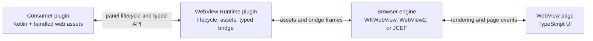

# WebView Runtime for IntelliJ

Build rich IDE interfaces with HTML, CSS, TypeScript, and your preferred frontend framework—without running a local web server.

WebView Runtime is an independently installed plugin for IntelliJ-based IDEs. A plugin owns the Kotlin lifecycle and business logic, bundles static frontend assets, and communicates with the page through typed Kotlin/TypeScript contracts.

## What It Provides

- Bundled frontend assets served from plugin resources through a virtual WebView origin.
- A typed JSON-RPC bridge built around `WebViewApi`, `WebViewApiId`, and `WebViewInterop`.
- A small TypeScript API exposed as `@nerzhulart/intellij-webview-sdk`.
- Native WKWebView and WebView2 backends, plus JCEF fallback.
- Browser previews, deterministic host mocks, and Playwright smoke tests.
- Shared Web Components and optional React controls styled for IDE UI.



## Markdown Lens

[Markdown Lens](https://plugins.jetbrains.com/plugin/33921-markdown-lens--preview-and-diff) is a Markdown preview plugin for JetBrains IDEs built on WebView Runtime. It supports Mermaid diagrams and rendered Markdown diffs, showing both versions side by side with synchronized scrolling and change markers.

[](https://www.youtube.com/watch?v=buoWWxdTRLw)

## Quick Start

Use the [WebView Runtime plugin on JetBrains Marketplace](https://plugins.jetbrains.com/plugin/33513-webview-runtime-experimental-) as the host for your consumer plugin. The example below uses runtime version `0.7.1-eap.3`; use the same release version for the TypeScript SDK.

### 1. Add the Runtime plugin dependency

Configure the IntelliJ Platform Gradle Plugin to resolve Marketplace plugins and add the runtime to your IDE dependencies:

```kotlin
repositories {
  intellijPlatform {
    defaultRepositories()
  }
}

dependencies {
  intellijPlatform {
    plugin("io.github.nerzhulart.webview:0.7.1-eap.3@eap")
  }
}
```

The `@eap` suffix selects the Marketplace EAP channel; omit it when using a stable release. Also declare the runtime as an external plugin dependency in your consumer plugin descriptor:

```xml
<dependencies>
  <plugin id="io.github.nerzhulart.webview"/>
</dependencies>
```

The runtime is installed alongside your consumer plugin; it is not bundled with the IDE or your plugin.

### 2. Install the TypeScript SDK

Add the exact SDK version matching the runtime plugin to your frontend package:

```shell
bun add --exact --dev @nerzhulart/intellij-webview-sdk@0.7.1-eap.3
```

Build the frontend as part of your plugin build and package its output under plugin resources; WebView Runtime serves those bundled assets, so a local HTTP server is not needed. See the [Hello WebView sample](samples/hello-webview/README.md) for a complete Gradle and Bun setup.

### 3. Create a WebView

Create and own the panel from Kotlin:

```kotlin
private val assetRoot = WebViewAssetRoot.forView("editor-tools")

suspend fun createEditorToolsPanel(scope: CoroutineScope): WebViewPanel {
  return createWebViewPanel(
    scope = scope,
    options = WebViewPanelOptions(
      assetRoot = assetRoot,
      debugName = "Editor tools",
    ),
  )
}
```

Create the panel and add `panel.component` to the Swing hierarchy on the EDT. The supplied `CoroutineScope` owns the panel's lifetime: cancel that scope when the owning UI is disposed; `WebViewPanel` has no separate `close()` method.

Define the same typed contract on both sides. Kotlin implements an API called by the page:

```kotlin
@Serializable
data class OpenFileRequest(val path: String)

interface EditorHostApi : WebViewImplementable {
  companion object {
    val ID: WebViewApiId<EditorHostApi> = WebViewApiId.of("editor.host")
  }

  suspend fun openFile(params: OpenFileRequest)
}

panel.interop.implement(EditorHostApi.ID, editorHostApi)
```

TypeScript calls it through `@nerzhulart/intellij-webview-sdk`:

```ts
import { apiId, webView, type WebViewCallable } from "@nerzhulart/intellij-webview-sdk"

interface EditorHostApi extends WebViewCallable {
  openFile(params: { path: string }): Promise<void>
}

const editorHostApiId = apiId<EditorHostApi>()("editor.host")
await webView.callable(editorHostApiId).openFile({ path: "src/Main.kt" })
```

See the [WebView UI Authoring Guide](docs/guides/WebView-UI-Authoring-Guide.md) for complete lifecycle, build, protocol, preview, and testing guidance, and [Frontend Package Distribution](docs/frontend/WebView-Frontend-Package-Distribution.md) for the npm package contract.

## Backend Support

| Backend | Current support |
| --- | --- |
| macOS WKWebView | Asset serving, typed messaging, Swing embedding, and interactive input |
| Windows WebView2 | Asset serving, typed messaging, Swing embedding, and interactive input |
| JCEF | Asset serving, typed messaging, Swing embedding, and interactive input |
| Linux WebKitGTK | Disabled implementation scaffold; supported Linux panels use JCEF |

## Project Status

The runtime and its public APIs are experimental. Compatibility may change between plugin releases.

Current distribution limitations:

- Source and published npm packages use the same `@nerzhulart/*` coordinates.
- Kotlin IDE test sources remain in the repository but are not wired into the standalone Gradle build.
- The target IDE build and minimum compatible build are configured in `gradle.properties` and `build.gradle.kts`.

## Build and Run

Use a JDK whose major version matches the selected binary IntelliJ SDK and the Gradle toolchain declared by this repository. Keep the SDK version, Gradle toolchain, Kotlin JVM target, and CI runtime aligned when upgrading the target IDE.

Install Bun through Homebrew or make it available on `PATH`, then run:

```shell
./gradlew buildPlugin :demo:buildPlugin :markdown-preview:buildPlugin
./gradlew runIde
```

On Windows, use `gradlew.bat` instead of `./gradlew`. A clean checkout requires the one-time wrapper bootstrap documented in [Standalone Development and Verification](docs/guides/Standalone-Development-and-Verification.md#bootstrap-the-gradle-wrapper).

The plugin ZIPs are written to the `build/distributions`, `demo/build/distributions`, and `markdown-preview/build/distributions` directories. For prerequisites, frontend commands, native builds, verification, and the release workflow, see [Standalone Development and Verification](docs/guides/Standalone-Development-and-Verification.md).

## Repository Guide

- `src/` — public Kotlin API and runtime implementation.
- `webview-src/` — TypeScript bridge, build helpers, testkit, and shared controls.
- `jcef/` — optional JCEF backend content module.
- `demo/` — runnable examples and browser-preview references.
- `markdown-preview/` — external Markdown preview plugin built on the runtime.
- `native/` — native system-WebView bridges.

Start at [WebView Runtime Documentation](docs/directory.md) for the complete documentation map.
