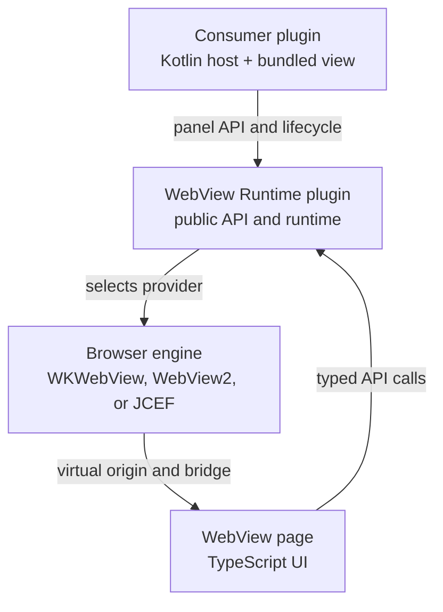
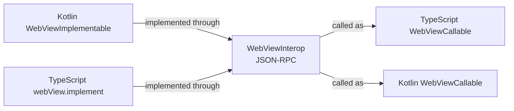
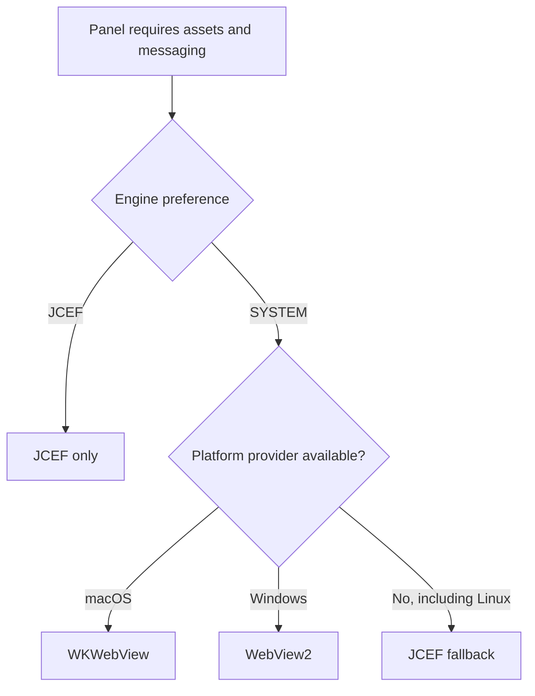
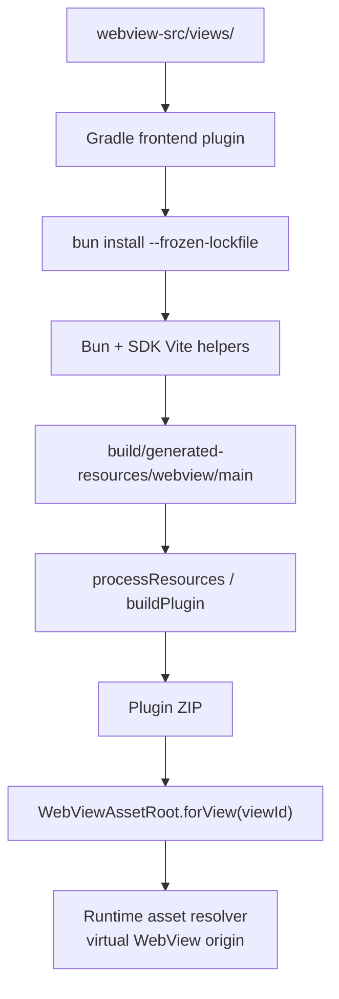
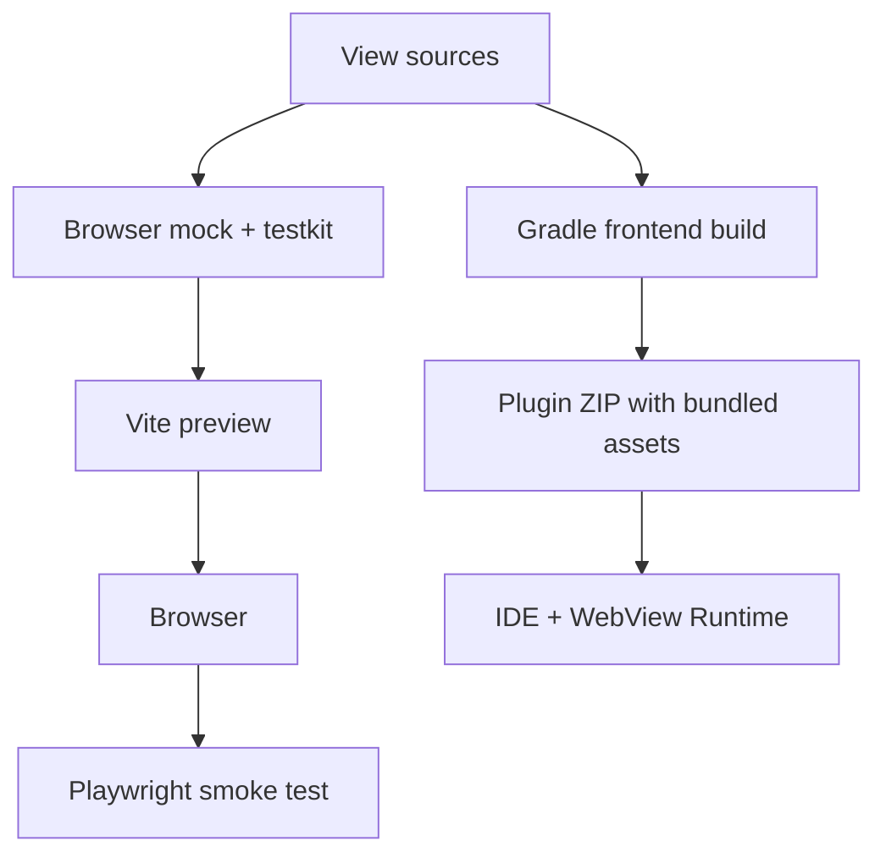

# WebView Runtime for IntelliJ

Build rich IDE interfaces with HTML, CSS, TypeScript, and your preferred frontend framework—without a local HTTP server in production.

WebView Runtime is an experimental, independently installed plugin for IntelliJ-based IDEs. A consumer plugin owns Kotlin lifecycle and business logic, bundles static frontend assets, and communicates with its page through typed Kotlin/TypeScript contracts.

## What It Provides

- Bundled frontend assets served from plugin resources through a virtual WebView origin.
- A typed JSON-RPC bridge built around `WebViewApi`, `WebViewApiId`, and `WebViewInterop`.
- A TypeScript SDK for typed calls and implementations.
- Native WKWebView and WebView2 backends, with JCEF fallback and cross-platform support.
- Browser previews, deterministic host mocks, and Playwright smoke tests through a separate testkit.
- Optional shared Web Components and React controls for IDE-styled UI.



## Create a WebView

Create the panel on EDT and own it with the scope of the UI that contains it:

```kotlin
private val assetRoot = WebViewAssetRoot.forView("editor-tools")

suspend fun createEditorToolsPanel(scope: CoroutineScope): WebViewPanel {
  return createWebViewPanel(
    scope = scope,
    options = WebViewPanelOptions(
      assetRoot = assetRoot,
      debugName = "Editor tools",
    ),
  )
}
```

Add `panel.component` to the Swing hierarchy on EDT. The supplied `CoroutineScope` is the panel's lifetime owner: cancel it when the owning UI is disposed. `WebViewPanel` has no separate `close()` method.

Define the same typed contract on both sides. Kotlin implements an API called by the page:

```kotlin
@Serializable
data class OpenFileRequest(val path: String)

interface EditorHostApi : WebViewImplementable {
  companion object {
    val ID: WebViewApiId<EditorHostApi> = WebViewApiId.of("editor.host")
  }

  suspend fun openFile(params: OpenFileRequest)
}

panel.interop.implement(EditorHostApi.ID, editorHostApi)
```

TypeScript calls it through `@nerzhulart/intellij-webview-sdk`:

```ts
import { apiId, webView, type WebViewCallable } from "@nerzhulart/intellij-webview-sdk"

interface EditorHostApi extends WebViewCallable {
  openFile(params: { path: string }): Promise<void>
}

const editorHostApiId = apiId<EditorHostApi>()("editor.host")
await webView.callable(editorHostApiId).openFile({ path: "src/Main.kt" })
```

The protocol is bidirectional: Kotlin APIs implemented with `WebViewImplementable` are called through TypeScript `WebViewCallable` proxies, and vice versa.



See the [WebView UI Authoring Guide](docs/guides/WebView-UI-Authoring-Guide.md) for lifecycle, protocol, build, preview, and testing guidance.

## Install and Depend on the Runtime

Build or download the WebView Runtime ZIP, install it in the target IDE, and declare the external plugin dependency in the consumer plugin descriptor:

```xml
<dependencies>
  <plugin id="io.github.nerzhulart.webview"/>
</dependencies>
```

`io.github.nerzhulart.webview` is the technical plugin ID. The runtime is not bundled with the IDE and must be installed alongside the consumer plugin.

Releases publish the runtime plugin to GitHub Releases and JetBrains Marketplace, and publish `@nerzhulart/intellij-webview-sdk` and `@nerzhulart/intellij-webview-sdk-testkit` to npm. Pin both npm packages to the exact version matching the runtime plugin; do not use floating semver ranges. The source manifests and shared controls packages remain private workspace packages, not public npm dependencies. See [Frontend Package Distribution](docs/frontend/WebView-Frontend-Package-Distribution.md) and the [Hello WebView consumer sample](samples/hello-webview/README.md).

## Backend Support

Engine providers are selected by availability and the configured preference. `SYSTEM` prefers a supported platform WebView and keeps JCEF as its configured fallback; `JCEF` selects JCEF without system providers. Consumer plugins use the common panel API rather than selecting a backend themselves.



| Backend | Current support |
| --- | --- |
| macOS WKWebView | Asset serving, typed messaging, Swing embedding, and interactive input |
| Windows WebView2 | Asset serving, typed messaging, Swing embedding, and interactive input |
| JCEF | Asset serving, typed messaging, Swing embedding, and interactive input; default asset-backed backend on Linux |
| Linux WebKitGTK | Disabled implementation scaffold; not selected |

## Build and Run

Use a JDK whose major version matches the selected binary IntelliJ SDK and the Gradle toolchain declared by this repository. Keep the SDK version, Gradle toolchain, Kotlin JVM target, and CI runtime aligned when upgrading the target IDE. Install Bun through Homebrew or make it available on `PATH`, then run:

```shell
./gradlew buildPlugin :demo:buildPlugin :markdown-preview:buildPlugin
./gradlew runIde
```

`buildPlugin` builds the frontend bundles and packages them as plugin resources. The Gradle task `buildAllWebViewAssets` builds frontend resources without assembling plugin ZIPs.



Generated output is packaged from `build/generated-resources/webview/main`; do not commit or hand-edit direct Bun output under `resources/webview`. On Windows, use `gradlew.bat` instead of `./gradlew`. A clean checkout requires the one-time wrapper bootstrap documented in [Standalone Development and Verification](docs/guides/Standalone-Development-and-Verification.md#bootstrap-the-gradle-wrapper).

The plugin ZIPs are written to `build/distributions`, `demo/build/distributions`, and `markdown-preview/build/distributions`. For prerequisites, frontend commands, native builds, verification, and release workflow details, see [Standalone Development and Verification](docs/guides/Standalone-Development-and-Verification.md).

## Browser Preview and Tests

The testkit runs browser previews with host mocks outside the IDE; production views continue to use bundled assets and the runtime plugin. The ACP chat demo provides a runnable preview (`bun run preview:acp-chat`) and a parameterized CLI (`bun webview-preview acp-chat --mock default`), both from `demo/webview-src`. The demo and Markdown preview also have Playwright smoke tests (`bun run test:browser` in their respective `webview-src` directories).



The [Hello WebView consumer sample](samples/hello-webview/README.md) shows a standalone plugin using the published runtime and SDK, with a Robot-driven IDE test.

## Project Status

The runtime and its public APIs are experimental; compatibility may change between plugin releases. A release produces the runtime, demo, and Markdown preview plugin ZIPs plus matching SDK and testkit packages from one version. Stable and prerelease releases use their respective Marketplace and npm channels. Because runtime capability negotiation is not implemented, consumers must pin both SDK packages to the installed runtime version.

Kotlin IDE test sources remain in the repository but are not wired into the standalone Gradle build. The target IDE build and minimum compatible build are configured in `gradle.properties` and `build.gradle.kts`.

## Repository Guide

- `src/` — public Kotlin API and runtime implementation, including common hosting, RPC, and platform engine code.
- `jcef/` — optional JCEF backend content module.
- `native/` — native WebView bridges, including the Windows WebView2 bridge and disabled Linux WebKitGTK scaffold.
- `webview-src/` — TypeScript SDK, Vite build helpers, testkit, and private shared controls packages.
- `demo/` — runnable IDE demo, browser-preview references, mocks, and smoke tests.
- `markdown-preview/` — external Markdown preview plugin built on the runtime.
- `samples/hello-webview/` — standalone consumer plugin example using published artifacts.

Start at [WebView Runtime Documentation](docs/directory.md) for the documentation map, including the [Runtime Architecture](docs/architecture/WebView-Runtime-Architecture.md), [Frontend Build](docs/frontend/WebView-Frontend-Build-Strategy.md), and [Frontend Package Distribution](docs/frontend/WebView-Frontend-Package-Distribution.md) references.
